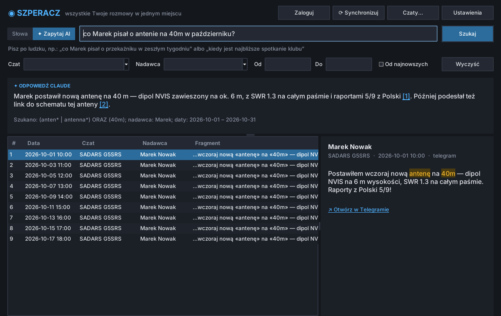
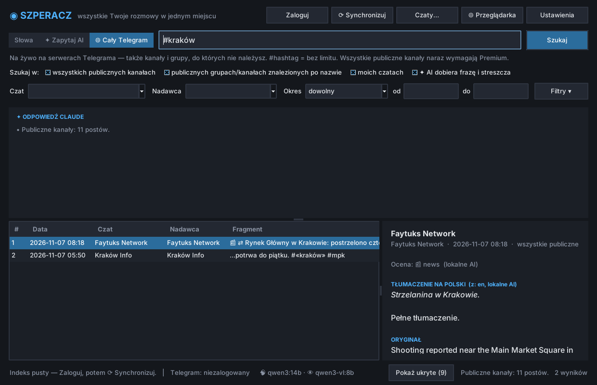
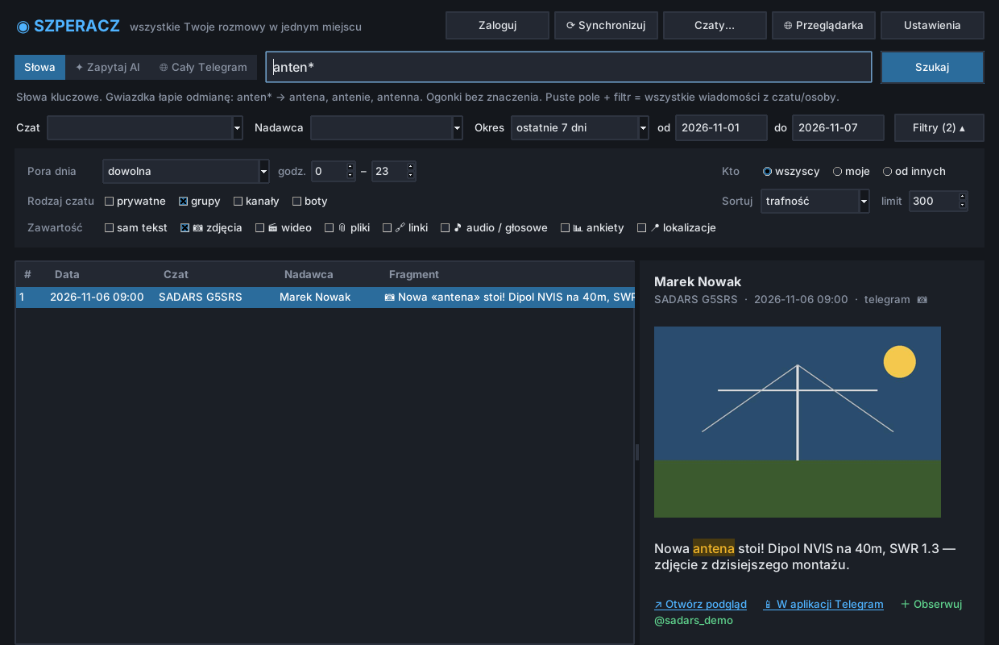
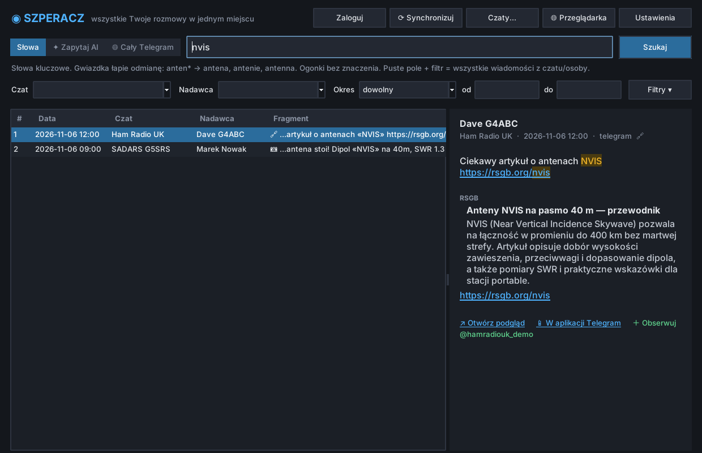
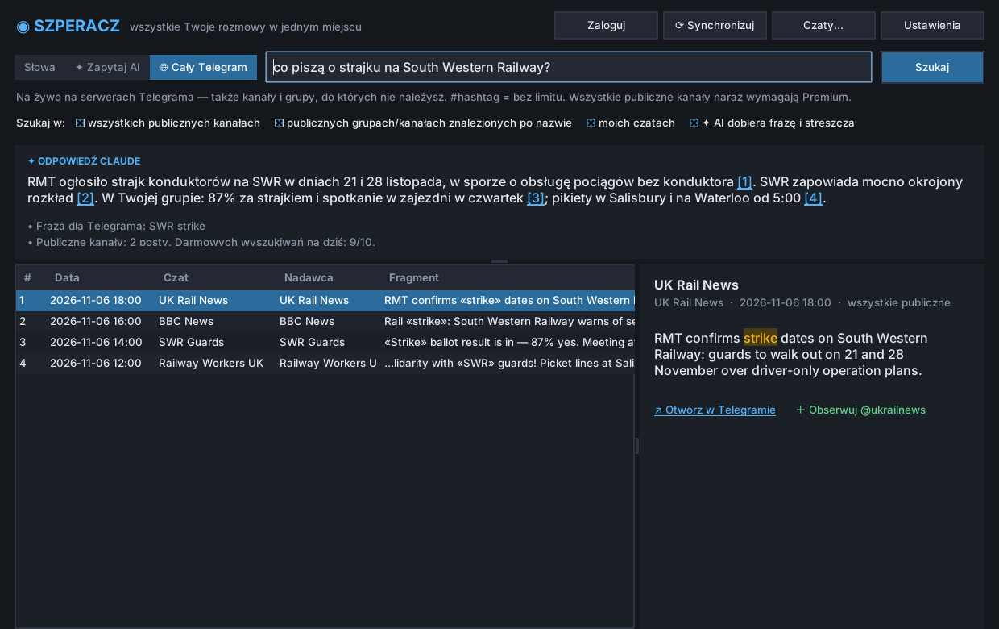
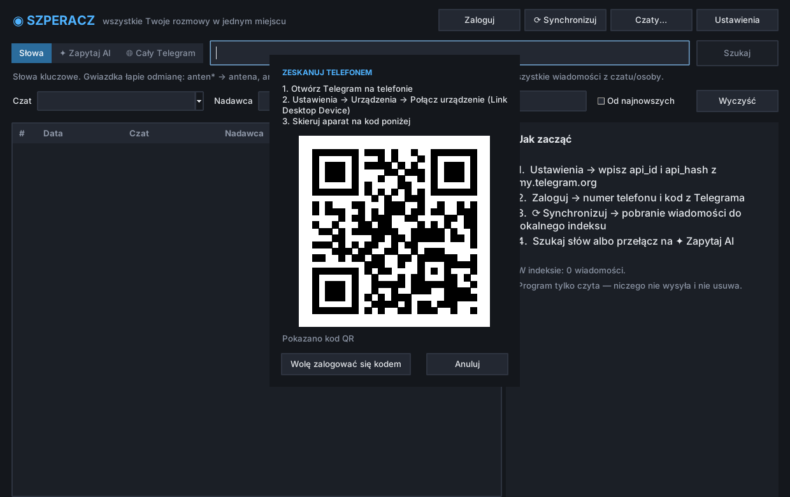

# 🔎 Szperacz

**Wyszukiwarka wiadomości z komunikatorów, z pytaniami po ludzku.**
Zamiast przewijać dziesiątki czatów, wpisujesz *„co Marek pisał o antenie na 40m w październiku?”*
i dostajesz odpowiedź z linkami do konkretnych wiadomości.

Etap 1: **Telegram** (Twoje czaty, grupy i kanały, a do tego szukanie w całym publicznym Telegramie).
Kolejne komunikatory dochodzą jako osobne konektory.



## Co potrafi

- **Lokalny indeks** (SQLite + FTS5): wyszukiwanie natychmiastowe, offline i za darmo.
  Polskie znaki nie mają znaczenia (`lukasz` znajdzie „Łukasz”), a gwiazdka łapie odmianę (`anten*` → antenie, antenna).
- **✦ Zapytaj AI**: piszesz po ludzku, Claude zamienia to na zapytanie (rdzenie, synonimy, daty
  typu „w zeszłym tygodniu”), a potem streszcza wyniki z numerami źródeł **[1] [2]**, które można kliknąć.
- **🌐 Cały Telegram**: szukanie na żywo na serwerach Telegrama, także w publicznych kanałach i grupach,
  do których nie należysz.
- **＋ Obserwuj**: dowolny publiczny kanał trafia do indeksu bez dołączania.
- **Podgląd ze zdjęciami**: zdjęcia, miniatury wideo i plików oraz pełne opisy podglądów linków
  (tytuł, strona, cały opis). Klikalne linki w treści.
- **🧠 Lokalne AI (Ollama / LM Studio)**: każdy wynik dostaje ocenę (news, rozmowa, reklama, spam, 18+,
  oszustwo). Spam i treści dla dorosłych są zwijane na dole listy. Obce języki są **automatycznie tłumaczone
  na polski**, a zdjęcia z kanałów spoza Twoich czatów pokazują się dopiero po sprawdzeniu modelem obrazu.
  Nic nie wychodzi do internetu.
- **Tarcza antyspamowa** (działa też bez AI): rozpoznaje typowy spam z wyszukiwania po hashtagach
  (obrazek + ściana przypadkowych tagów, konta-persony, kasyna, 18+). Przycisk „🚫 Ukryj ten kanał na zawsze”.
- **Filtry**: okres (dziś, wczoraj, 7/30 dni, miesiąc, rok…), pora dnia, rodzaj czatu, zawartość
  (zdjęcia, wideo, pliki, linki, audio, ankiety, lokalizacje), moje lub cudze wiadomości, sortowanie.
- **🌐 Wbudowana przeglądarka** (silnik Edge WebView2): linki otwierają się w Szperaczu, a publiczne
  posty w pełnym podglądzie ze zdjęciami. Logowania na stronach są zapamiętywane.
- **Logowanie kodem QR**: skanujesz telefonem, kod SMS niepotrzebny.
- **Tylko odczyt**: program niczego nie wysyła, nie edytuje i nie usuwa.
- Okno (Tkinter, ciemny motyw), wiersz poleceń i gotowe exe dla Windows.



| Filtry i zdjęcia w podglądzie | Pełny opis podglądu linku |
|---|---|
|  |  |

| Cały Telegram | Logowanie QR |
|---|---|
|  |  |

*Zrzuty pokazują przykładowe, zmyślone dane.*

## Prywatność

Wiadomości są trzymane wyłącznie na Twoim komputerze (`dane/indeks.sqlite`). Do Claude
trafiają tylko przy pytaniach AI: Twój prompt, nazwy czatów i nadawców (żeby AI rozpoznało
„grupa klubowa” → „SADARS”) oraz znalezione wiadomości. Klucze i sesja Telegrama są
w `config.toml` i `dane/`, które są w `.gitignore`.

## Najprościej: dwuklik

1. Zainstaluj Python 3.11+ z python.org (zaznacz „Add python.exe to PATH”).
2. Kliknij dwa razy **`Szperacz.bat`**. Za pierwszym razem zainstaluje biblioteki
   (około minuty), potem otworzy się okno Szperacza.
3. Przy pierwszym uruchomieniu otworzą się Ustawienia: wpisz `api_id` i `api_hash`
   z my.telegram.org (link jest w oknie) i opcjonalnie klucz Claude API.
4. **Zaloguj**: pojawi się kod QR. Na telefonie otwórz Telegram → Ustawienia → Urządzenia →
   Połącz urządzenie i zeskanuj kod. Możesz też wybrać „Wolę zalogować się kodem”.
   Potem **⟳ Synchronizuj** i szukaj.

### Okno
- **Słowa** albo **✦ Zapytaj AI**: przełącznik obok pola wyszukiwania.
- Filtry: czat i nadawca (podpowiedzi z indeksu), daty od–do, „Od najnowszych”.
- Klik w wynik pokazuje całą wiadomość z podświetlonymi trafieniami.
  Dwuklik albo „↗ Otwórz w Telegramie” otwiera wiadomość w Telegramie.
- W odpowiedzi AI numery **[1]**, **[2]**… można kliknąć: zaznaczają źródło na liście.
- **Czaty…**: lista czatów; zaznacz kilka i zsynchronizuj tylko je.
- **🌐 Cały Telegram**: szukanie na żywo na serwerach Telegrama, także tam, gdzie Cię nie ma (opis niżej).
- **＋ Obserwuj @kanał** przy wyniku z publicznego kanału: kanał trafia do indeksu bez dołączania.
- **Filtry ▾** rozwija panel: pora dnia (rano, wieczór, noc, godziny pracy, własne), rodzaj czatu,
  zawartość, „moje / od innych”, sortowanie (trafność, najnowsze, najstarsze), limit wyników.
  Filtry działają we wszystkich trybach, także w 🌐 Całym Telegramie.
- Podgląd wiadomości pokazuje zdjęcie, a dla linków pełny opis strony. Zdjęcia są pobierane
  na żądanie i zapisywane w `dane/media`, więc drugi raz otwierają się od razu, także offline.
- **🌐 Przeglądarka** w nagłówku otwiera Telegram Web. Linki z wiadomości otwierają się w tym
  samym oknie. Prywatne grupy (linki `t.me/c/…`) otwierają się w aplikacji Telegram, bo w sieci
  nie mają podglądu. W menu przeglądarki: Wstecz, Dalej, Odśwież, Wpisz adres, Otwórz w aplikacji Telegram.
- Skróty: Enter = szukaj, Ctrl+F = pole wyszukiwania, Esc = wyczyść pole.

### Exe
Po pierwszym uruchomieniu `Szperacz.bat` kliknij **`zbuduj_exe.bat`**. Powstaną:
- `Szperacz.exe`: okno (Python już niepotrzebny),
- `SzperaczCLI.exe`: wersja konsolowa, np. do Harmonogramu zadań: `SzperaczCLI.exe sync`.

Oba używają `config.toml` i folderu `dane` z folderu, w którym leżą.
Niepodpisany exe może wywołać ostrzeżenie SmartScreen: „Więcej informacji → Uruchom mimo to”.

## Instalacja ręczna (Windows)

Potrzebny Python 3.11 lub nowszy.

```powershell
git clone https://github.com/vipersq/szperacz.git
cd szperacz
py -m venv .venv
.venv\Scripts\activate
pip install -e .
copy config.example.toml config.toml
```

## Konfiguracja Telegrama (jednorazowo)

1. Wejdź na https://my.telegram.org i zaloguj się numerem telefonu.
2. **API development tools** → utwórz aplikację (nazwa dowolna, np. „Szperacz”,
   platforma: Desktop).
3. Skopiuj `api_id` i `api_hash` do `config.toml`, do sekcji `[telegram]`.
4. Zaloguj się:
   ```powershell
   szperacz login        # albo: szperacz login --qr
   ```
   Podaj numer, kod z aplikacji Telegram i ewentualnie hasło 2FA.

> ⚠️ Plik `dane/telegram.session` daje pełny dostęp do Twojego konta Telegram.
> Nie wysyłaj go nikomu i nie wrzucaj do repozytorium (jest w `.gitignore`).
> Sesję unieważnisz w Telegramie: Ustawienia → Urządzenia.

## Użycie

```powershell
szperacz czaty                 # lista czatów; ✓ = będzie indeksowany
szperacz sync                  # pobierz wiadomości (kolejne uruchomienia dociągają tylko nowe)
szperacz sync --czat SADARS --limit 2000
szperacz stat
szperacz gui                   # okno
szperacz menu                  # menu tekstowe w konsoli

# wyszukiwanie bez AI — darmowe i natychmiastowe
szperacz szukaj anten* 40m
szperacz szukaj przekaznik --czat sadars --od 2026-10-01 --najnowsze
szperacz szukaj --nadawca marek -n 50
szperacz szukaj --fts "anten* NOT tuner"
szperacz szukaj anten* --tresc photo --typ grupa --godz 18-23 --najstarsze
szperacz szukaj --moje --od 2026-11-01

# pytanie po ludzku (Claude)
set ANTHROPIC_API_KEY=sk-ant-...
szperacz pytaj co Marek pisał o antenie na 40m w zeszłym miesiącu
szperacz pytaj kiedy jest najbliższe spotkanie klubu --bez-odpowiedzi
```

### Wskazówki do wyszukiwania
- Ogonki nie mają znaczenia: `przekaznik` znajdzie „przekaźnik”, `lukasz` znajdzie „Łukasz”.
- Gwiazdka łapie odmianę: `anten*` → antena, antenę, antenie, antenna.
- Kilka słów = wszystkie naraz. Jeśli nic nie pasuje, program pokaże wiadomości
  z którymkolwiek słowem.
- `pytaj` robi to samo za Ciebie: dobiera rdzenie, synonimy i angielskie odpowiedniki,
  zamienia „w zeszłym tygodniu” na daty, a potem streszcza wyniki z numerami źródeł.

### Synchronizacja automatyczna
Harmonogram zadań Windows → nowe zadanie co godzinę:
`<folder projektu>\.venv\Scripts\szperacz.exe sync` (albo `SzperaczCLI.exe sync`),
folder startowy = folder projektu.

## 🧠 Lokalne AI

Szperacz korzysta z Ollamy (albo LM Studio) na Twoim komputerze, tej samej co KRONOS-7.
Modele wybiera sam z zainstalowanych:

| Zadanie | Model (domyślnie) | Rozmiar |
|---|---|---|
| ocena wyników i tłumaczenie | `qwen3:14b` (albo inny zainstalowany model tekstowy) | ok. 9 GB |
| sprawdzanie zdjęć | `qwen3-vl:8b`, do pobrania jednym kliknięciem w pasku na dole | ok. 6 GB |

- Po każdym wyszukiwaniu wyniki są oceniane w tle (partiami, z pamięcią podręczną w `dane/ai_cache.sqlite`).
- Spam i 18+ trafiają na dół listy pod przyciskiem **Pokaż ukryte (N)** (albo znikają całkiem, jeśli tak ustawisz).
- Wiadomości w obcym języku mają na liście polskie tłumaczenie (⇄), a w podglądzie pełne tłumaczenie,
  jednozdaniowe streszczenie i oryginał.
- Zdjęcie z kanału spoza Twoich czatów jest najpierw sprawdzane modelem obrazu. Nieodpowiednie zostaje
  zasłonięte z opcją „Pokaż mimo to”. Bez modelu obrazu takie zdjęcia są zasłonięte, dopóki ich nie odsłonisz.
- Ustawienia: **Ustawienia → Lokalne AI** (adres, modele, tłumaczenie, sprawdzanie zdjęć, zwijanie / usuwanie, tarcza).

## 🌐 Szukanie w całym Telegramie

Tryb „Cały Telegram” w oknie albo `szperacz wszedzie` w konsoli łączy cztery źródła:

| Źródło | Co obejmuje | Warunki |
|---|---|---|
| Wszystkie publiczne kanały | posty ze **wszystkich** publicznych kanałów, także tych, do których nie należysz | **Telegram Premium**: darmowy dzienny limit, potem płatne gwiazdkami (⭐). `#hashtag` działa bez limitu. |
| Kanały/grupy znalezione po nazwie | publiczne kanały i grupy, których nazwa pasuje do zapytania; przeszukiwane od środka | bez dołączania, za darmo |
| Twoje czaty | wszystkie Twoje czaty, także te jeszcze niezsynchronizowane | za darmo |
| Obserwowane | kanały z listy `obserwowane` w ustawieniach | za darmo |

**Gwiazdki nigdy nie schodzą automatycznie.** Po wyczerpaniu darmowego limitu okno
pyta o zgodę, a w konsoli trzeba dodać `--zaplac N`.

Prywatnych grup i kanałów, w których Cię nie ma, nie da się przeszukać żadnym
programem: Telegram tego nie udostępnia.

Serwer Telegrama dopasowuje zwykłe słowa (bez gwiazdek). Z włączonym „✦ AI” Claude
najpierw zamienia pytanie po ludzku na krótką frazę, np. „SWR strike”, a na koniec
streszcza wyniki.

```powershell
szperacz wszedzie strajk SWR
szperacz wszedzie --ai "co piszą o strajku na South Western Railway"
szperacz wszedzie "#hamradio"
szperacz obserwuj @bbcnews https://t.me/jakis_kanal
szperacz sync        # pobiera także obserwowane (domyślnie ostatnie 2000 wiadomości na start)
```

## Koszty AI
`pytaj` to dwa wywołania: małe do Haiku (prompt → zapytanie) i jedno do Sonneta
z maks. 40 wiadomościami. Zwykle wychodzi poniżej kilku pensów za pytanie.
Modele zmienisz w `config.toml`, sekcja `[ai]`.

## Budowa
```
szperacz/
  models.py            wspólny format: Message, ChatInfo, Query, Hit
  connectors/base.py   interfejs konektora (każdy komunikator to jedna klasa)
  connectors/telegram.py
  index.py             SQLite + FTS5, polskie znaki, fragmenty z podświetleniem
  sync.py              przyrostowa synchronizacja konektor → indeks
  ai.py                Claude: prompt → zapytanie, wyniki → odpowiedź
  service.py           logika wspólna dla okna i konsoli
  gui.py               okno (Tkinter)
  browser.py           wbudowana przeglądarka (pywebview / Edge WebView2, osobny proces)
  localai.py           lokalne AI: Ollama / LM Studio, ocena, tłumaczenie, zdjęcia, cache
  shield.py            tarcza antyspamowa (reguły bez AI)
  cli.py               polecenia
tests/                 testy (pytest), bez sieci: udawany Telegram i udawany Claude
docs/                  zrzuty ekranu
```

Testy: `pip install -e .[dev]`, potem `pytest`.

Nowy komunikator = nowa klasa w `connectors/` z `list_chats()` i `fetch()`.
Indeks i wyszukiwarka zostają bez zmian.

## Plany
- Kolejne komunikatory: Signal (signal-cli / Signal Desktop), WhatsApp (import eksportu czatów),
  Messenger (import „Pobierz swoje informacje”), Discord (bot na własnych serwerach).
- Wykrywanie edycji starszych wiadomości.

## Ograniczenia etapu 1
- Edycje starszych wiadomości nie są wykrywane (dociągane są tylko nowe).
  Pełne odświeżenie czatu: usuń jego wpis z `sync_state` albo cały indeks.
- Pliki i zdjęcia są przeszukiwane po podpisie i nazwie pliku, bez zawartości (zdjęcia widać w podglądzie).
- Wbudowana przeglądarka wymaga Microsoft Edge WebView2. W Windows 10/11 zwykle jest zainstalowany.
  Jeśli go brakuje, linki otwierają się w zwykłej przeglądarce.
- Czaty tajne (secret chats) nie są dostępne przez API: istnieją tylko na telefonie.
